# Smoke-отчёт

Дата: 2026-10-24 16:26. Сценариев пройдено: 5 из 5.

| Сценарий | Результат | Шагов | Упало |
|---|---|---|---|
| Приветствие и справка | ✅ прошёл | 2 | 0 |
| Профиль и инвариант smart-агента | ✅ прошёл | 16 | 0 |
| История агента и её сброс | ✅ прошёл | 3 | 0 |
| Очередь вопросов пуста | ✅ прошёл | 3 | 0 |
| Групповой чат игнорируется | ✅ прошёл | 2 | 0 |

## Приветствие и справка

1. ✅ **/start** — `/start`
   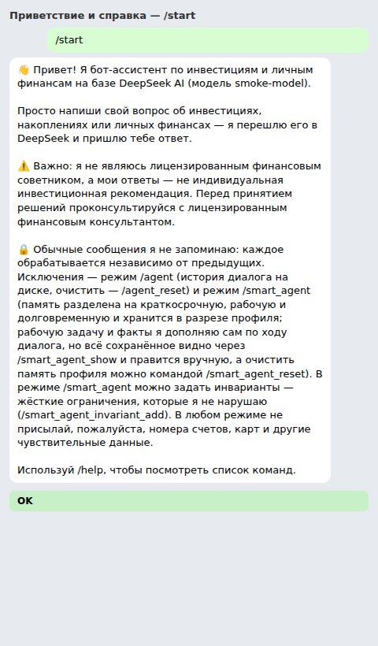
2. ✅ **/help** — `/help`
   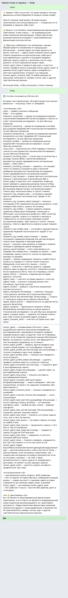

## Профиль и инвариант smart-агента

1. ✅ **без профиля инвариант не добавить** — `/smart_agent_invariant_add без плеча`
   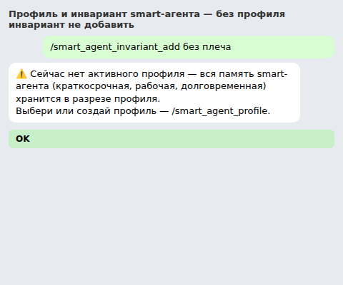
2. ✅ **открыть выбор профиля** — `/smart_agent_profile`
   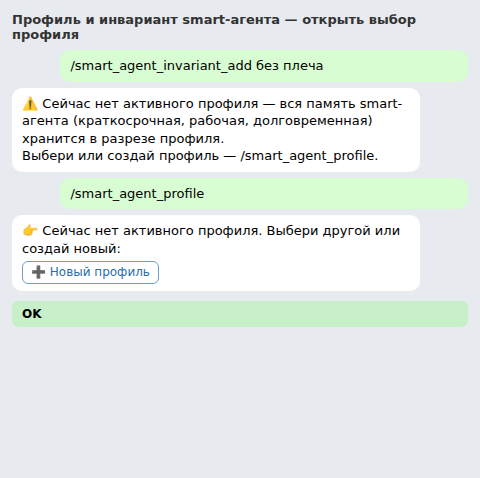
3. ✅ **новый профиль** — `[кнопка] Новый профиль`
   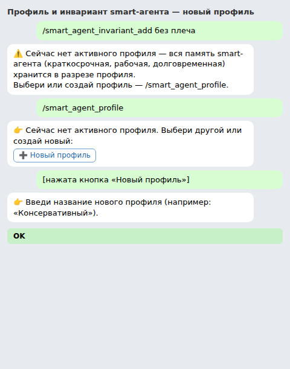
4. ✅ **имя профиля** — `Тестовый`
   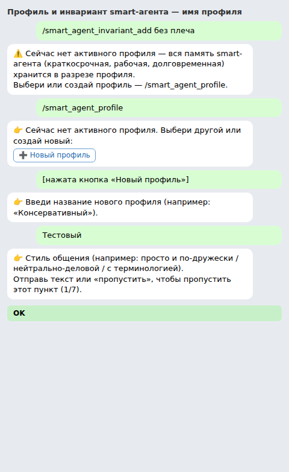
5. ✅ **стиль** — `коротко и по делу`
   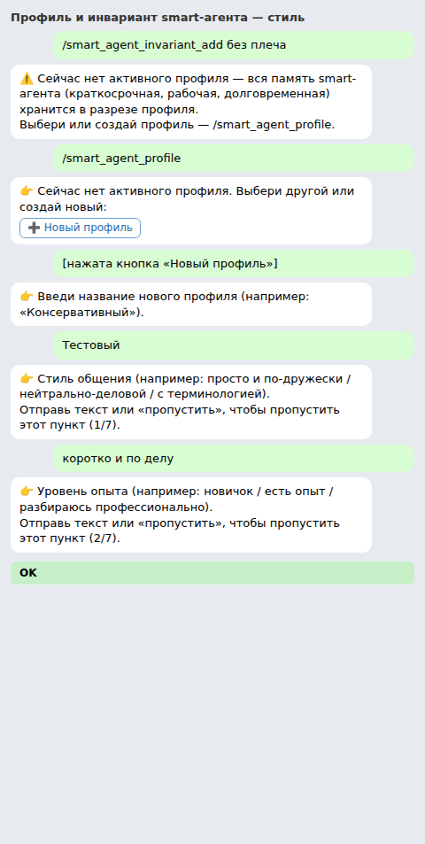
6. ✅ **опыт** — `пропустить`
   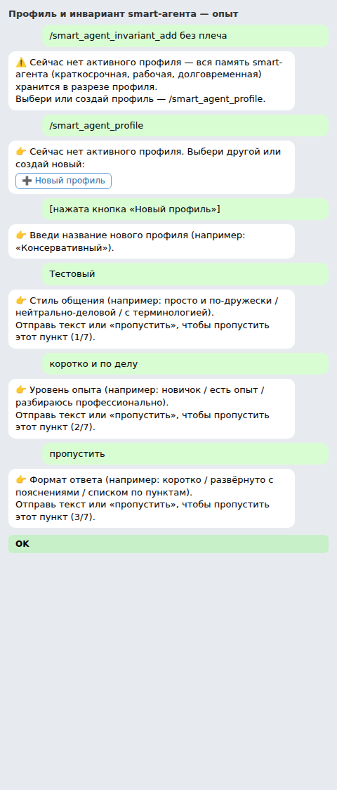
7. ✅ **формат** — `пропустить`
   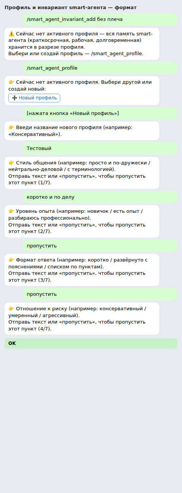
8. ✅ **риск** — `пропустить`
   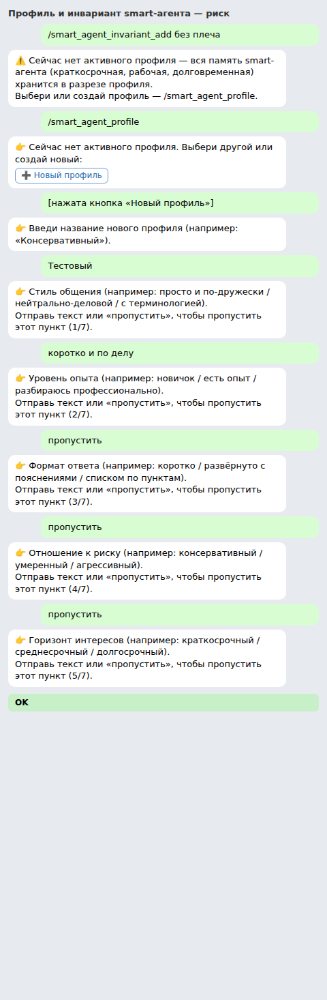
9. ✅ **горизонт** — `пропустить`
   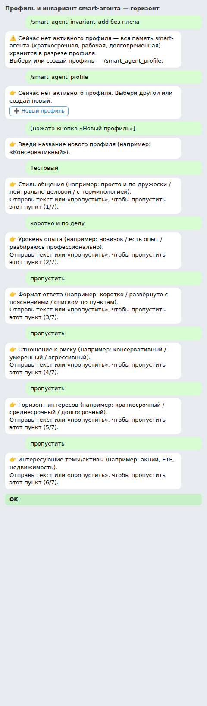
10. ✅ **интересы** — `пропустить`
   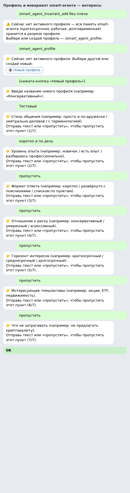
11. ✅ **последний пункт, профиль создан** — `пропустить`
   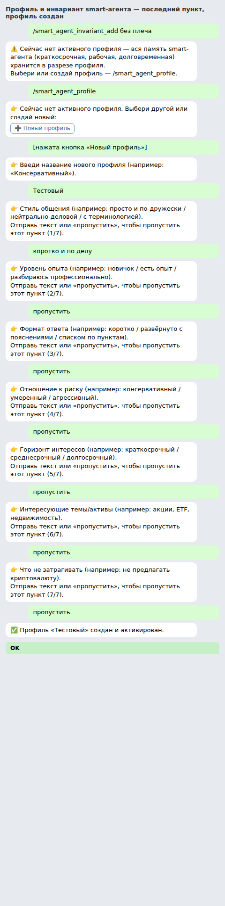
12. ✅ **добавить инвариант** — `/smart_agent_invariant_add инструменты: без криптовалют`
   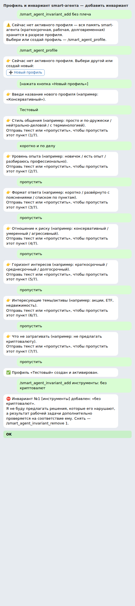
13. ✅ **инвариант виден в списке** — `/smart_agent_invariant_show`
   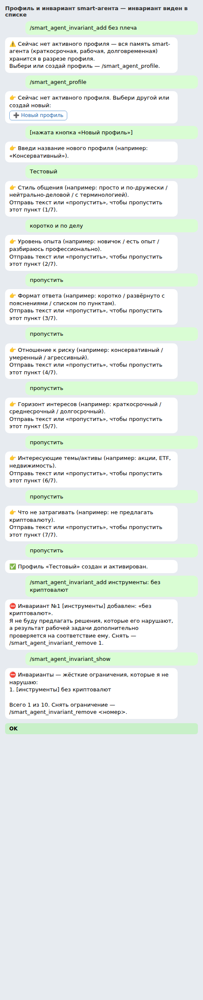
14. ✅ **снять инвариант** — `/smart_agent_invariant_remove 1`
   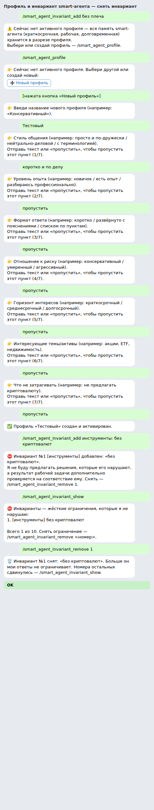
15. ✅ **список снова пуст** — `/smart_agent_invariant_show`
   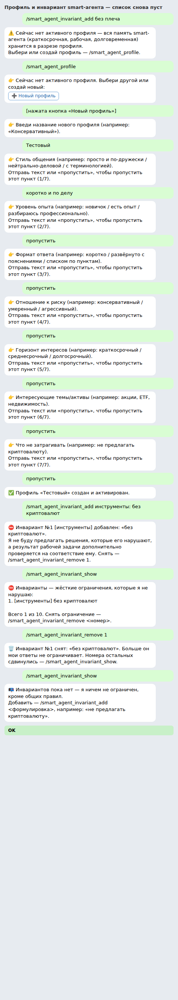
16. ✅ **удалить профиль** — `/smart_agent_profile_delete Тестовый`
   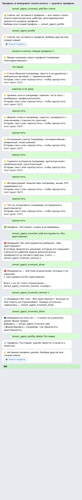

## История агента и её сброс

1. ✅ **история пуста** — `/agent_history`
   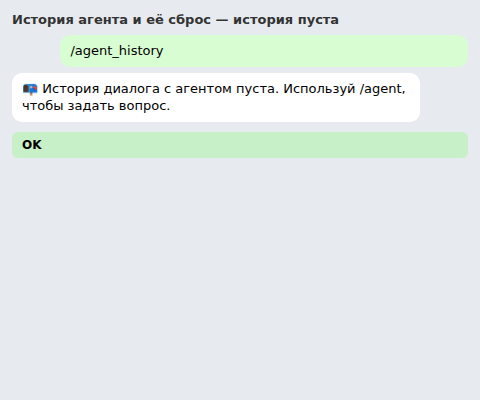
2. ✅ **сброс** — `/agent_reset`
   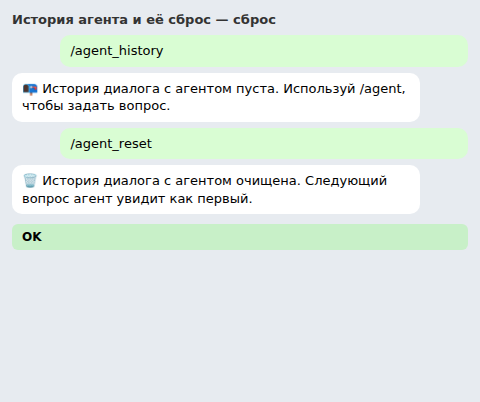
3. ✅ **история по-прежнему пуста** — `/agent_history`
   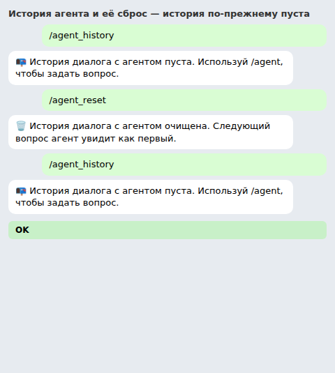

## Очередь вопросов пуста

1. ✅ **список очереди** — `/queue`
   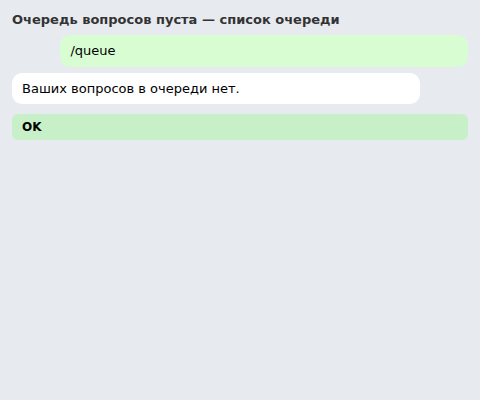
2. ✅ **отмена пустой очереди** — `/queue_cancel`
   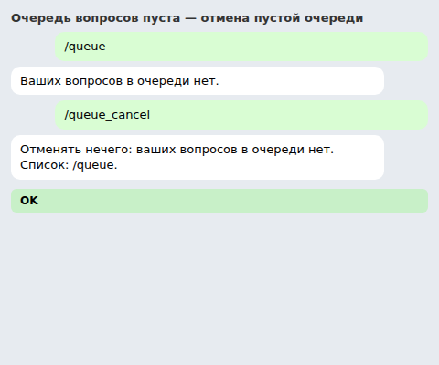
3. ✅ **отмена по номеру тоже безопасна** — `/queue_cancel 3`
   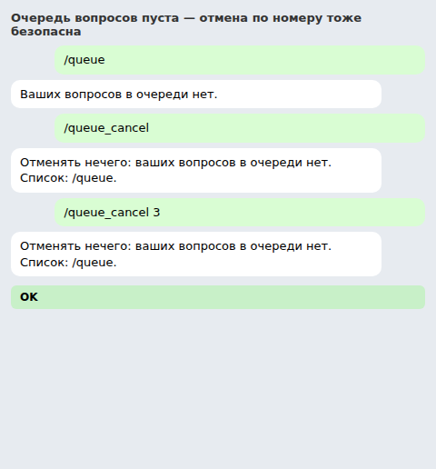

## Групповой чат игнорируется

1. ✅ **обычный текст в группе** — `Какие акции сейчас лучше купить?`
   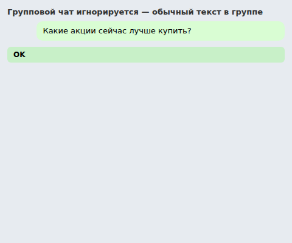
2. ✅ **команда очереди в группе** — `/queue`
   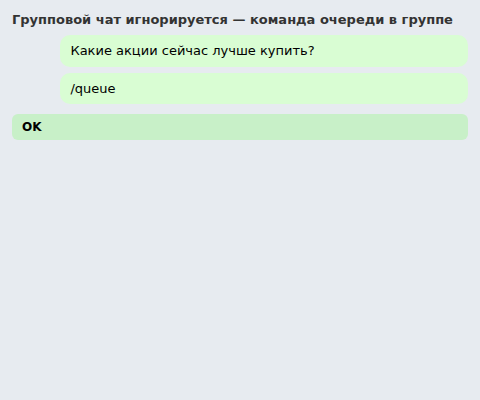
